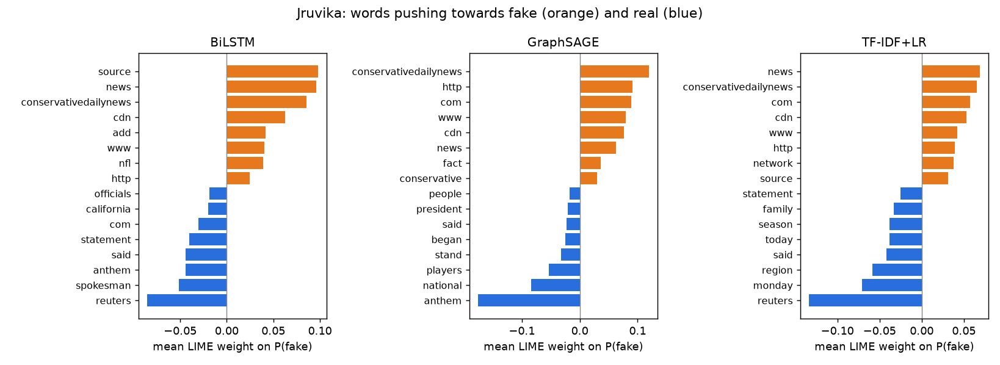
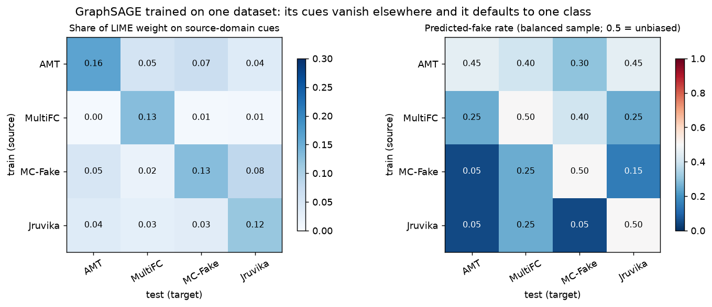

# Explainability: LIME and SHAP across model families

Which words make each model say **fake**, do different model families rely on the same
evidence, and does that evidence explain why models trained on one dataset fail on another?
This module applies **LIME** and **SHAP** (Week 9, explainable AI) to the team's
traditional, sequential and graph models, without retraining or modifying them.

| Family | Model explained | Trained on | Source |
|---|---|---|---|
| Traditional | TF-IDF (1–2 gram) + logistic regression | pooled 4 datasets; also one per dataset | same settings as `trung/baseline_tfidf.py`, refitted here |
| Sequential | GloVe-100d BiLSTM | pooled 4 datasets | `sequential/checkpoints/bilstm_glove100_seed42` |
| Graph | GraphSAGE on a TF-IDF/SVD kNN document graph | one model per dataset | `Swetha/Models/*.joblib` |
| Transformer | RoBERTa/DeBERTa (optional) | pooled | Trung's Hugging Face repo, see [below](#transformers) |

The wrappers reproduce the recorded test scores (BiLSTM exactly; TF-IDF within 0.012 on AMT;
GraphSAGE MultiFC 0.6368 vs 0.6367). GraphSAGE Jruvika gives 0.990 rather than 0.979
because Swetha's split manifest drops 15 duplicate texts from that test set.

## How the explanations work

Both methods treat a model as a black box that maps text to P(fake). Words that **raise**
P(fake) get positive weights (orange in the figures); words that lower it get negative
weights (blue).

* **LIME** deletes random subsets of words (500 perturbations per text), re-scores each
  variant and fits a distance-weighted linear model. The coefficients are the local word
  weights.
* **SHAP** (partition explainer, text masker, 500 evaluations) gives each word its Shapley
  value: its average marginal contribution over coalitions of words. The values add up to
  P(fake) minus the prediction for the fully masked text.

Long articles are cut to their first 256 words before explaining. The BiLSTM and the
transformers read only the head of the text anyway.

**Sample.** 30 label-balanced test texts per dataset (150 for MultiFC, whose claims are
short) × 3 families × 2 methods = 1,260 local explanations. A further 640 LIME
explanations cover the single-source models on every train → test pair. Global "cues" are
averaged over the local explanations, ranked by mean weight × √(texts containing the word),
with stopwords removed.

## Findings

### 1. The explanations are faithful
If LIME/SHAP really find the words a model uses, deleting those words should change the
prediction far more than deleting random words. It does
([faithfulness.csv](results/faithfulness.csv), [faithfulness.png](results/faithfulness.png)):

| | drop in predicted-class prob., top-5 words removed | 5 random words removed | prediction flips |
|---|---:|---:|---:|
| TF-IDF+LR (LIME / SHAP) | 0.34 / 0.28 | 0.01 / 0.02 | 65% / 54% |
| BiLSTM (LIME / SHAP) | 0.30 / 0.20 | 0.02 / 0.01 | 57% / 40% |
| GraphSAGE (LIME / SHAP) | 0.17 / 0.14 | 0.02 / 0.02 | 60% / 54% |

Removing just five words flips about half of all predictions. LIME scores slightly higher
here because its perturbations are deletions, like this test. Partition SHAP, at 500
evaluations, spreads credit over neighbouring words.

### 2. The models decide on publisher and style cues, not on facts


The [shortcut audit](results/shortcut_audit.csv) counts how often each top cue occurs in
fake versus real documents across the whole test set:

* **Jruvika.** All three families put their top "fake" weight on the footprint of one
  publisher: `conservativedailynews` and `cdn` appear in 22% of fake articles and **0%** of
  real ones. `www` appears in 55% of fakes vs 1.6% of reals, and `http` in 66% vs 1.1%. The
  top "real" cue is `reuters` (32% of real articles, 1.9% of fakes), then wire-report
  vocabulary (`said`, `spokesman`, `statement`, `monday`). This explains why even TF-IDF
  scores 0.945 on Jruvika: the label can be read off the source.
* **MC-Fake.** "Real" is again newswire style (`reuters`, `told`, `said`, weekdays).
  "Fake" is celebrity gossip (`kardashian`, `dating`, `rumors`, `insider`, `exclusively`,
  `source`). The label is largely a topic and genre label.
* **MultiFC** (short claims). Fake cues are politicians' names (`hillary`, `obama`,
  `clinton`, `trump`) and `shows` (viral "photo shows…" claims). Real cues are numbers and
  statistics (`percent`, `million`, `average`, `percentage`). Ratings follow the type of
  claim more than its truth, and the effects are weaker (×1.5–2), which matches the low
  0.64–0.71 F1 every family gets here.
* **AMT** has only 24 + 24 test texts, so its cues are noisy (most ratios are close to 1)
  and shouldn't be over-read.

### 3. Counterfactual stress test: style-only edits flip predictions
To check the shortcut finding causally, [`stress_test.csv`](results/stress_test.csv)
adds a phrase that changes no factual claim to every test text. The phrase is either a
newswire byline (*"WASHINGTON (Reuters) - A spokesman said in a statement on Tuesday:"*) or
a blog source line (*"Source: http://www.conservativedailynews.com news"*):

| dataset, model | fake texts still flagged fake after the byline | real texts flagged fake after the blog line |
|---|---|---|
| MultiFC, TF-IDF+LR | 88% → **0.5%** | 60% → 99% |
| MultiFC, BiLSTM | 84% → 14% | 54% → 92% |
| MC-Fake, TF-IDF+LR | 49% → 26% | 4% → 13% |
| MC-Fake, BiLSTM | 54% → 38% | 5% → 16% |
| Jruvika, BiLSTM | 94% → 77% | 6% → **31%** |
| Jruvika, GraphSAGE | 99% → 97% | 1% → 12% |

A one-line byline hides most fake claims from the bag-of-words and sequential models. Short
claims are hit hardest because the added words outweigh the claim. GraphSAGE is the most
robust: its prediction also averages over the 10 most similar training documents, and a
single line barely changes which documents those are.

### 4. Families agree on short claims and disagree on articles
On the same texts, word rankings correlate only weakly between families on long articles
(Spearman 0.11–0.39, top-10 Jaccard 0.06–0.31). On MultiFC claims they correlate more
strongly (Spearman 0.31–0.44, Jaccard 0.56–0.69). LIME and SHAP agree with each other in
the same way: 0.19–0.55 on articles and 0.76–0.84 on claims
([agreement.csv](results/agreement.csv)).

On claims, the top 5 words carry 65–78% of all attribution, against 15–28% on articles
([evidence_concentration.csv](results/evidence_concentration.csv)). A claim is decided by
a handful of words, so every model and method finds the same handful. An article offers
many redundant cues, and each model latches onto a different subset. On articles,
explanations from a single model or method should therefore not be read as "the" reason.

### 5. Why models don't transfer across datasets
Single-source TF-IDF+LR transfer matrix (test macro-F1;
[tfidf_transfer_matrix.csv](results/tfidf_transfer_matrix.csv)). This completes the 4×4
matrices the team already has for GraphSAGE and RoBERTa:

| train \ test | AMT | MultiFC | MC-Fake | Jruvika |
|---|---:|---:|---:|---:|
| AMT | **0.748** | 0.480 | 0.498 | 0.646 |
| MultiFC | 0.624 | **0.680** | 0.495 | 0.598 |
| MC-Fake | 0.420 | 0.463 | **0.792** | 0.483 |
| Jruvika | 0.367 | 0.301 | 0.515 | **0.980** |

The explanations show what goes wrong
([transfer_cue_analysis.csv](results/transfer_cue_analysis.csv),
[transfer_cue_overlap.csv](results/transfer_cue_overlap.csv)):



* **Each dataset teaches a different notion of "fake".** The top-25 fake-cue lists of
  different source datasets share almost nothing: Jaccard 0–0.04 for TF-IDF and 0–0.02 for
  GraphSAGE ([transfer_source_cues.csv](results/transfer_source_cues.csv)).
* **The cues disappear out of domain.** In-domain, 9–22% of a model's LIME weight lands on
  its own top cues. On other datasets this falls to 0–9% (left panel), so the model is
  deciding on words it never learned to rely on.
* **Without its cues, the model falls back to one class.** On balanced target samples, the
  models trained on Jruvika or MC-Fake label only 0–15% of AMT/MC-Fake/Jruvika texts as
  fake (right panel; 50% would be unbiased). Their idea of "fake" (a blog URL, celebrity
  gossip) is simply absent elsewhere. The MultiFC-trained TF-IDF model drifts the other
  way and calls 55–65% of news articles fake.
* **A cue can even reverse meaning.** For example, `hollywood` is a fake cue in MC-Fake
  (gossip sites) and a real cue in Jruvika.

### What this means outside these datasets
For the intended users, fact-checkers and news readers, the models currently act as
**source and genre detectors**. They would flag a true story re-posted by a blog with a URL
footer, and pass a fabricated story written in wire-service style ("officials said on
Tuesday"). The same mechanism explains the poor cross-domain transfer: each dataset's
labels line up with a different stylistic artefact, so pooling the datasets (as the BiLSTM
and transformer runs do) helps mainly by letting the model memorise every dataset's
artefacts, not by learning veracity. The fixes these findings suggest:

1. strip URLs, bylines, publisher names and boilerplate in preprocessing;
2. split train/test by publisher so that source cues can't leak;
3. keep this stress test as a robustness check for any new model.

## Files

| File | What it does |
|---|---|
| `data.py` | Loads `binary_{train,dev,test}` for all four datasets; extracts the MC-Fake/Jruvika 7z archives with py7zr. |
| `models.py` | One `predict_proba(texts)` interface for each model (registry names: `tfidf_lr`, `tfidf_lr:<dataset>`, `bilstm`, `graphsage:<dataset>`, `transformer:<run>`). |
| `explainers.py` | `lime_explain`, `shap_explain`, `deletion_check`, `highlight_html`. Plain-dict outputs, reusable by the Streamlit app. |
| `analysis.py` | The `explain`, `transfer`, `stress` and `report` stages. |
| `tests/test_explainers.py` | Checks LIME and SHAP on a toy model whose cue words are known. |
| `results/` | All tables and figures above, the raw explanations (`*.jsonl`), and [`examples.html`](results/examples.html) with highlighted side-by-side explanations. |

## Reproduce

Python 3.10+ on CPU (the whole pipeline takes about 25 minutes on a laptop). From the
repository root:

```sh
python -m venv .venv
```

```sh
.venv/Scripts/python -m pip install -r explainability/requirements.txt
```

```sh
.venv/Scripts/python explainability/analysis.py explain
```

```sh
.venv/Scripts/python explainability/analysis.py explain --datasets multifc --n 120
```

```sh
.venv/Scripts/python explainability/analysis.py transfer
```

```sh
.venv/Scripts/python explainability/analysis.py stress
```

```sh
.venv/Scripts/python explainability/analysis.py report
```

On Linux/macOS use `.venv/bin/python`. `scikit-learn` is pinned to 1.5.2, the version the
GraphSAGE models were saved with. The `explain` and `transfer` stages append to their
JSONL files and skip finished work, so re-running resumes an interrupted run. Extracted
data and the fitted TF-IDF models go to `explainability/cache/` (ignored by Git).

Using it from other code (for example the Streamlit app):

```python
import sys; sys.path.insert(0, "explainability")
from models import load_model
from explainers import lime_explain, highlight_html

model = load_model("bilstm")
result = lime_explain(model, "Photo shows Hillary Clinton at a secret meeting")
result["p_fake"], highlight_html(result["text"], result["weights"])
```

### Transformers
`--extra-models transformer:roberta_adamw` (or `deberta_adamw`, `roberta_muon_lr5e-5`) adds
Trung's fine-tuned models from `ngqtrung/ee6405-misinfo-detection`. This needs
`pip install transformers` and downloads each checkpoint (about 0.5 GB). A GPU is
recommended, because LIME calls the model 500 times per text. These runs are not included
in the results above. Trung's [Integrated Gradients analysis](../trung/README.md#interpretation-files-in-resultsruninterp)
already found the same `reuters` / `caption` / `copyright` publisher cues for RoBERTa.

## Limitations
* The explanations use samples (30–150 texts per dataset), not whole test sets. The
  stress test and shortcut audit do use the full test sets.
* LIME and SHAP explain one prediction at a time. The "global cues" are averages over
  those, not exact model weights (except that TF-IDF+LR's LIME cues can be checked against
  its coefficients via `TfidfLR.coefficients()`).
* Word-level explanations can't capture word order, which matters for the BiLSTM.
* All models are single-seed, and AMT is too small for firm conclusions.
